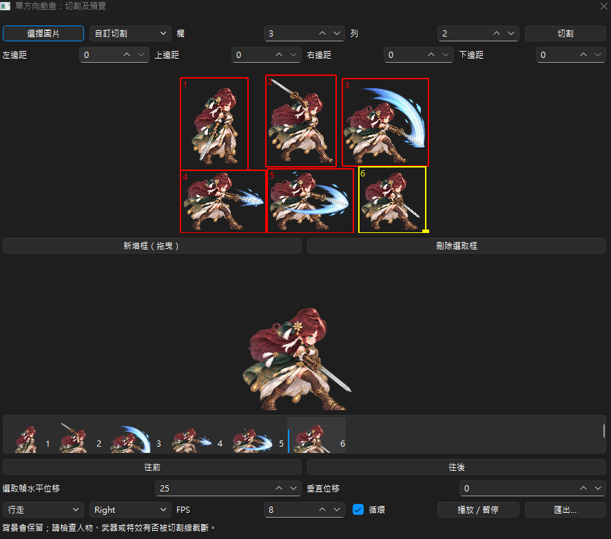

# Anime RPG Sprite Studio

0.6.0 測試版：Windows / Python 3.12 Sprite 編輯、CPU 動畫、匯出、AI 候選與品質檢查。



## 啟動

免安裝版請解壓 ZIP 後執行 AnimeRpgSpriteStudio.exe，保留整個 _internal。
這是未簽章的內部測試包；使用與建置方式見 [Windows 測試版](docs/windows-release.md)。
以下為原始碼環境的啟動方式：

```powershell
.\.venv\Scripts\python.exe -m pip install -e ".[test]"
.\.venv\Scripts\python.exe -m anime_rpg_sprite_studio
```

## 測試

```powershell
.\.venv\Scripts\python.exe -m pytest -q
```

新建專案、增加角色、編輯名稱與描述、調整 FPS，儲存為 project.json。
開啟時保留草稿並提示缺失素材。Mock 按鈕只顯示透明測試占位圖，
不會加入動畫幀，也不會存入專案。腳底十字使用左下原點 Pivot (0.5, 0)。
方向列序 Front、Left、Right、Back，每方向幀序 0–3。

## Sprite 匯入與播放

「檔案 → 單方向圖片切割／動畫…」可載入整張網格圖片，設定欄列後檢查
紅色切割線；可用四邊邊距調整整體切割範圍，再按「切割」更新預覽。
使用往前／往後排列影格，選擇行走或攻擊、方向、FPS 和循環。
匯出建立獨立資料夾，包含每幀 PNG、橫向 sheet.png 和 animation.json。
切割保留原始背景及影格尺寸；網格必須整除圖片尺寸，不會自動去背或生成新姿勢。
此工具為獨立流程，六幀動畫不會寫入既有四方向專案。

選「自訂切割」可在圖片上拖曳建立不同大小的框；按「新增框（拖曳）」
可從已有框內開始建立重疊框。點選框後拖曳移動，拖右下角黃色方塊調整大小，
也可在縮圖選取後刪除或排序。逐幀水平／垂直位移以像素計算，預設下方置中；
為避免裁切，超出時會自動擴大所有影格共用的透明畫布。原本互相重疊的角色
不能靠矩形框自動分離。切換切割模式會清除目前的框及排序。

先新增角色並儲存專案，選擇方向及幀槽，再點「匯入 PNG」。
可選 1 張（目前幀槽）或 4 張（確認對話框列出幀 0–3 的對應檔名）。
只接受單幀 256×256 PNG；轉換 RGBA 並保留透明度，不縮放或去背。
圖片解碼在背景執行，完成後才一次更新素材與幀資料。
該方向 4 幀都有效後可播放／暫停，點縮圖可逐幀查看；FPS 1–60。
切換角色或方向會停止播放並回到幀 0。匯入中切換會捨棄先前結果。
Mock 顯示僅供診斷，不會覆蓋已匯入的動畫幀。

素材複製到專案 assets/，另存到不同目錄時會複製所有已參照素材。
遺失來源素材時另存失敗並保留原專案。匯入中須等待完成才能另存。
尚未儲存的素材替換不會刪除舊圖，以避免破壞已儲存專案；因此可能
留下未參照素材，暫不提供自動清理。

## 分層模板與 CPU Walk

點「分層模板／生成 Walk」，載入內建測試模板或
`examples/six-layer-demo/template.json`。調整手臂／腿部擺幅及身體起伏，
生成四方向 16 幀候選。可切方向、播放或選幀；候選不會修改既有動畫。
明確確認套用後才會複製模板素材並取代 Walk，再儲存專案即可保留設定。
關閉或取消則保留原動畫。各層規格與完整流程見 [模板格式](docs/template-format.md)。

模板為預先對齊的六層 PNG，不會自動拆圖；測試人偶非 AI 成果。
動作是簡單的剛性圖層旋轉與位移，可能有接縫、腳滑或裁切，需人工檢查。

## 匯出

角色的四方向 Walk 各有 4 幀後，點「匯出…」。全部圖片驗證通過才可開始。
選擇輸出位置，會建立新的 walk-… 資料夾，內含 16 張獨立 PNG、
1024×1024 透明 Sprite Sheet 與動畫 JSON。可取消，失敗保留既有匯出。
不含 Unity 匯出。座標、檔名、JSON 與取消規則見 [匯出格式](docs/export-format.md)。

## AI 候選與預算

按「AI 候選／預算」，預設離線 Mock。fal.ai 僅支援 FLUX.1 Schnell，
先取得即時官方報價，再明確確認一筆請求；不自動重試或切換模型。
Key 經 Windows Credential Manager 保存；預算 SQLite 使用 Decimal、UTC 月份。
停止門檻 US$4.50，未決費用保留，不能保證供應商帳單永遠不超過 US$5。
候選圖片獨立保存，不自動加入動畫。設定與恢復方式見 [AI 使用說明](docs/ai-usage.md)。

Phase 5 實作僅以假 Key／假 HTTP 驗收，未執行真實付費 API 或實際憑證後端操作。
## 品質與預覽輔助

完整 16 幀可按「一致性檢查」，候選視窗也可在套用前檢查。
工具以透明輪廓提示位置、尺寸、背景與裁切風險，不判斷角色身份或自動修圖。
勾選腳底線及前後幀疊影可人工檢查抖動與腳滑；這些輔助不影響輸出圖片。

Phase 6 已加入本機免安裝版驗收；乾淨 Windows 10/11、長時間使用、真實憑證、
實際付費 API 與公開發佈授權仍未驗證。請勿將本機通過視為生產環境保證。
沒有網路或 Key 仍可使用 Mock、Sprite 編輯、CPU 動畫與匯出。
啟動不存取 keyring 或外部網路；開啟 AI 工具才初始化帳本。

專案格式為 schema_version=2 的 UTF-8 JSON；可讀取 schema 1 並升級。
素材路徑必須在專案內。舊版程式無法讀取新的 schema 2 專案。
移動有素材的專案請搬移整個資料夾，或使用另存新檔。
