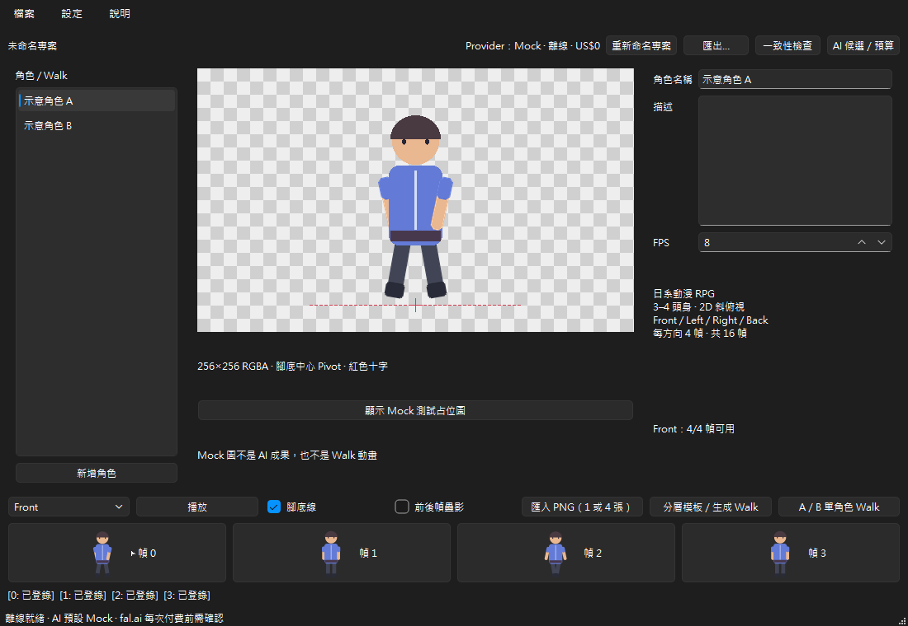
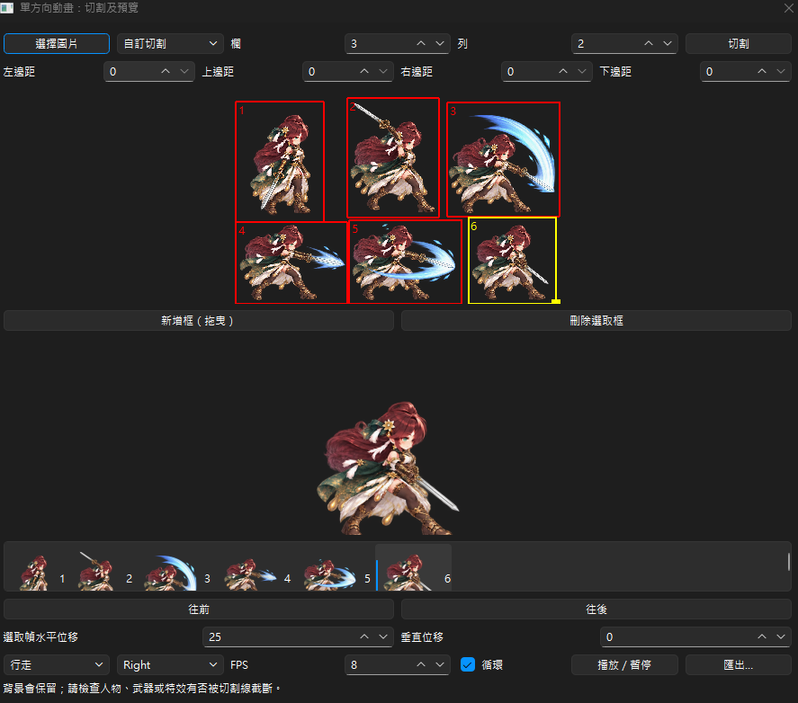
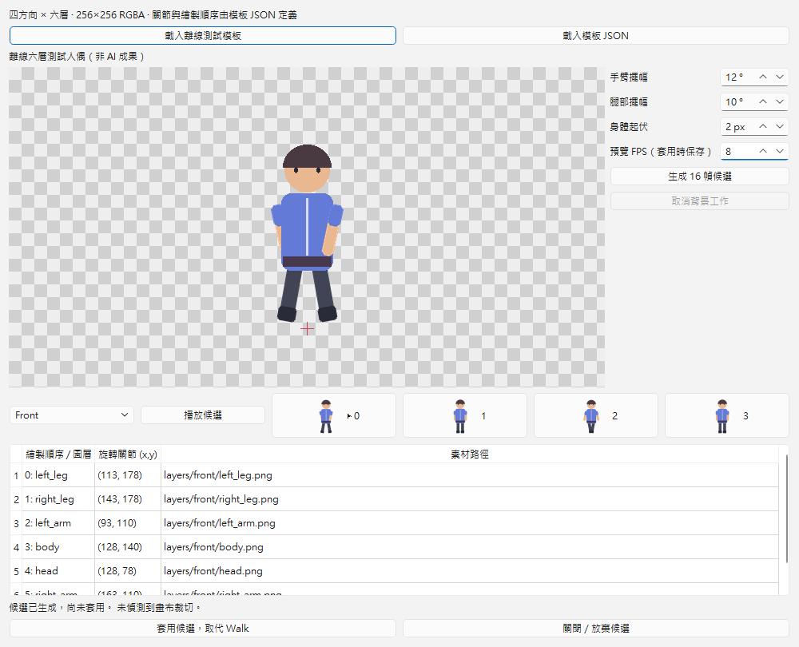
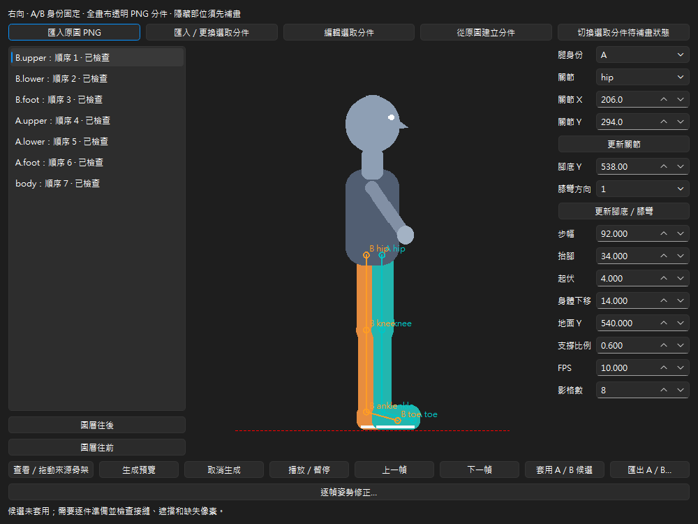
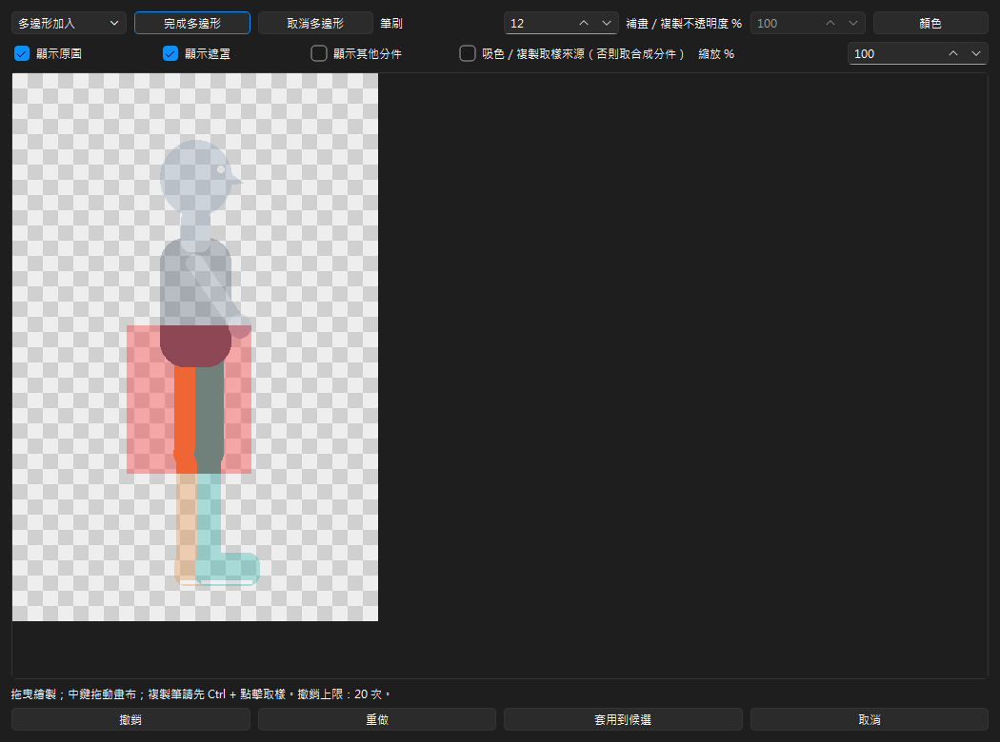
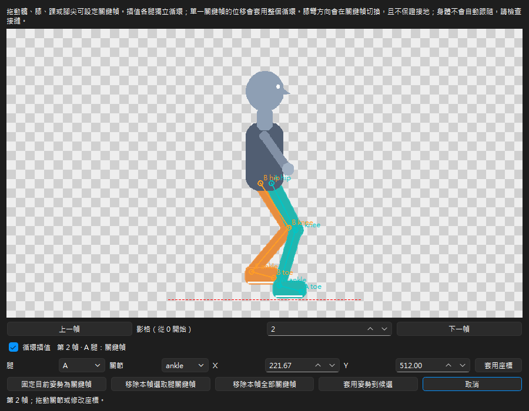
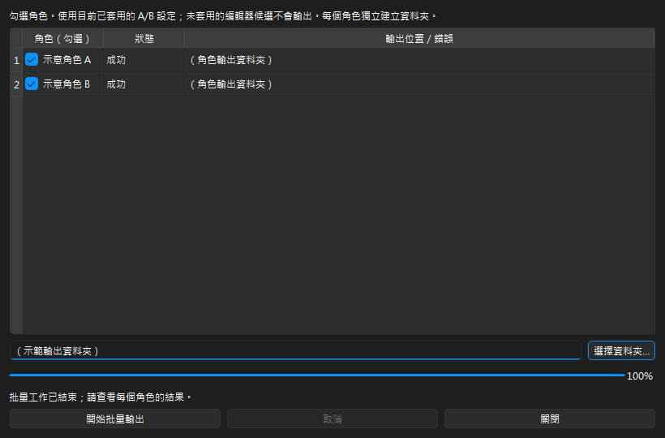
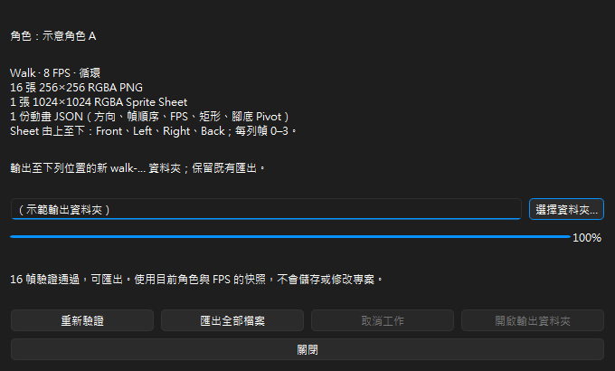
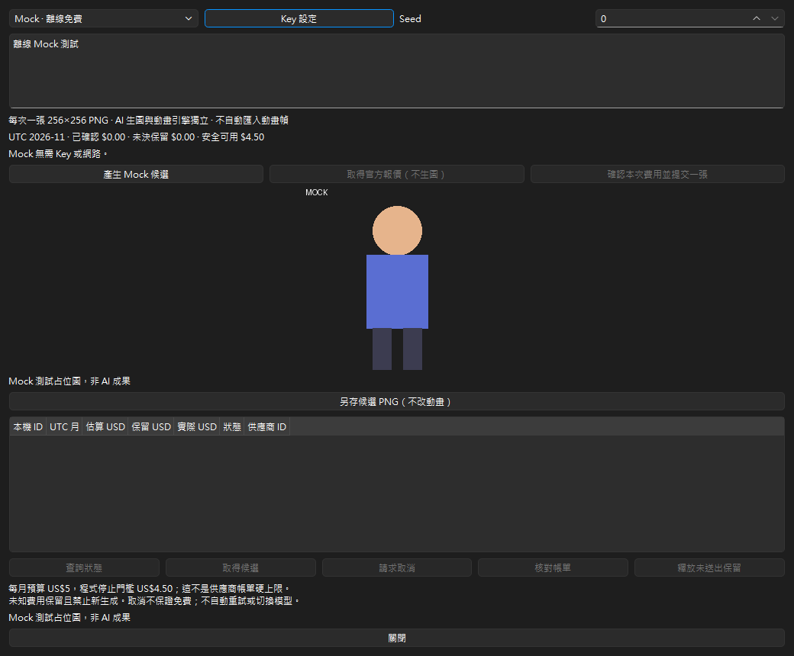

# Anime RPG Sprite Studio

Windows 桌面 Sprite 工具：匯入圖片、製作及預覽行走動畫、手動修正分件，並匯出 PNG、Sprite Sheet 和動畫 JSON。動畫處理使用 CPU；不需要本機 AI 模型或 GPU。



上圖及部分教學圖片使用示意角色；實際成果取決於匯入的素材和手動調整。

## 目錄

- [啟動與建立專案](#啟動與建立專案)
- [匯入四方向圖片及播放](#匯入四方向圖片及播放)
- [切割單方向行走或攻擊圖片](#切割單方向行走或攻擊圖片)
- [四方向分層模板動畫](#四方向分層模板動畫)
- [A／B 單角色行走動畫](#ab-單角色行走動畫)
- [分件遮罩與補畫](#分件遮罩與補畫)
- [逐幀姿勢修正及關鍵幀插值](#逐幀姿勢修正及關鍵幀插值)
- [A／B 匯出與多角色批量輸出](#ab-匯出與多角色批量輸出)
- [四方向動畫匯出](#四方向動畫匯出)
- [品質檢查與預覽輔助](#品質檢查與預覽輔助)
- [AI 候選與預算](#ai-候選與預算)
- [測試與專案相容性](#測試與專案相容性)

## 啟動與建立專案

Windows 測試版請解壓完整 ZIP，執行 `AnimeRpgSpriteStudio.exe`，並保留旁邊的 `_internal` 資料夾。這是未簽章的測試包，使用與建置方式見 [Windows 測試版](docs/windows-release.md)。

使用原始碼時，準備 Python 3.12 虛擬環境，然後執行：

```powershell
.\.venv\Scripts\python.exe -m pip install -e ".[test]"
.\.venv\Scripts\python.exe -m anime_rpg_sprite_studio
```

1. 建立專案，按「新增角色」，填寫角色名稱和描述。
2. 儲存專案後，再匯入素材或開始編輯。
3. 專案以 `project.json` 記錄角色與設定；匯入的圖片仍是 PNG，素材複製到專案的 `assets/` 資料夾。
4. 移動專案時請連同素材資料夾一起搬移，或使用「另存新檔」。遺失素材時，另存會停止並保留原專案。

## 匯入四方向圖片及播放


1. 選取角色及方向 Front、Left、Right 或 Back，再選擇下方影格。
2. 按「匯入 PNG（1 或 4 張）」。選 1 張會放入目前影格；選 4 張時，請確認對話框顯示的幀 0–3 對應順序。
3. 每張必須是 **256×256 PNG**；程式轉成 RGBA，保留透明度，不會縮放或去背。
4. 該方向四幀齊備後可播放或點選縮圖查看；FPS 預設 8，可調整為 1–60。切換角色或方向會停止播放並回到幀 0。

四方向流程共 16 幀，腳底中心 Pivot 為 `(0.5, 0)`（左下原點）。匯入在背景處理，完成前切換角色或方向會捨棄該次結果。

## 切割單方向行走或攻擊圖片



1. 選「檔案 → 單方向圖片切割／動畫…」，選擇整張圖片。
2. 圖片排列平均時，設定欄、列和四邊邊距，按「切割」並檢查紅線；有效範圍必須能被欄列整除。
3. 圖片排列不平均或各幀大小不同時，選「自訂切割」，在圖片上拖曳每個框。選框後可移動、拖動右下角調整大小、刪除或排序；「新增框（拖曳）」可建立重疊框。
4. 使用縮圖、往前／往後按鈕排列順序；設定行走或攻擊、方向、FPS、循環及逐幀水平／垂直位移，再播放檢查。
5. 按「匯出…」，輸出獨立 PNG、橫向 `sheet.png` 和 `animation.json`。

切割保留原背景，不會去背或生成新姿勢。不同大小的框會放進共同畫布；位移超出時畫布會擴大以避免裁切。重疊人物不能由矩形框自動分離。此流程獨立於四方向專案；切換切割模式會清除目前框及排序。

## 四方向分層模板動畫



1. 選取已儲存的角色，按「分層模板／生成 Walk」。
2. 載入內建測試模板或 `examples/six-layer-demo/template.json`，調整手腳擺幅及身體起伏。
3. 生成候選後切換方向、播放及逐幀檢查；確認套用後，再儲存專案。

模板需要預先對齊的六層 PNG，不會自動拆分圖片。程式以剛性圖層旋轉及位移生成動作，可能有接縫、腳滑或裁切；候選取消後不會取代原動畫。詳細素材規格見 [模板格式](docs/template-format.md)。

## A／B 單角色行走動畫



A／B 流程獨立於既有四方向 Walk，預設使用原畫布、右向 **8 幀／10 FPS**。

1. 新增角色並儲存專案，按「A／B 單角色 Walk」。
2. 匯入角色原圖 PNG；再匯入 `body`、A／B 各自的 `upper`、`lower`、`foot`，共七張透明分件。分件畫布須與原圖同尺寸。
3. 調整部件前後繪製順序，並標示需要補畫或已檢查的部件。
4. 在骨架畫面拖動關節，或選擇 A／B 腿及關節輸入座標；按需要調整腳底、地面及步態參數。
5. 按「生成預覽」，播放並逐幀檢查。留意不可達及裁切警告。
6. 按「套用 A／B 候選」，然後儲存專案。套用只更新 A／B 資料，不會取代四方向動畫。

單張合併圖中被身體或衣物遮擋的部分，可能需要自行補畫；粗略切割不代表已取得完整分件。剛性分件亦可能出現接縫或穿插。

## 分件遮罩與補畫



1. 在 A／B 視窗選擇部件，按「從原圖建立分件」或「編輯選取分件」。
2. 用多邊形或遮罩筆刷選取需要保留的區域；使用遮罩橡皮擦修正邊緣。
3. 用補畫筆、橡皮擦、吸色或複製筆修整缺失部分。複製筆先按住 **Ctrl 並點擊**取樣；可切換從合成分件或來源圖取樣。
4. 中鍵拖動畫布，並可調整縮放。完成後先套用到候選，再套用 A／B 候選及儲存專案。

原圖、遮罩、補畫與合成圖片分開保存。參考顯示的其他分件不會被複製；遮罩及橡皮擦為硬邊，不透明度用於補畫筆與複製筆。每張圖上限 400 萬像素；來源尺寸不同時可選擇相同畫布尺寸的參考圖。

## 逐幀姿勢修正及關鍵幀插值



1. 生成 A／B 預覽後開啟「逐幀姿勢修正」，選擇影格及 A 或 B 腿。
2. 拖動髖、膝、踝、腳尖，或輸入座標；膝與踝依固定骨長解算，調整腳尖會旋轉腳掌。可還原本幀或單腿。
3. 為需要控制的腿新增關鍵幀，勾選「循環插值」，讓修正跨影格銜接，包括最後一幀至第一幀；亦可移除所選腿的關鍵幀。
4. 播放檢查後，確認套用至 A／B 候選，再套用候選及儲存專案。

單一關鍵幀的修正會作用於整個循環的原步態。新角色預設啟用循環插值；舊專案維持原有逐幀行為，可自行啟用。膝彎方向在關鍵幀切換，插值不保證自動接地，請檢查腳滑、接縫及不可達提示。更改影格總數前，程式會詢問是否清除逐幀修正。

## A／B 匯出與多角色批量輸出



**單角色：**在 A／B 視窗按「匯出 A／B…」並選擇目的地。程式輸出目前候選快照，建立新資料夾，內含透明逐幀 PNG、四欄 `spritesheet.png` 及 `animation.json`。匯出不會自動套用候選或儲存專案。

**多角色：**先為每個角色套用 A／B 設定，再選「檔案 → A／B 多角色批量輸出」，勾選角色、選擇資料夾並開始。視窗顯示進度及每個角色的成功、失敗或取消結果；每個成功角色有獨立資料夾，取消時保留已完成輸出。批量輸出使用已套用設定，不包含仍在編輯器中未套用的候選；工作期間請勿在其他程式修改素材。

JSON 中 `expected_contact` 是預定支撐狀態，`ground_error` 是旋轉後鞋底參考點相對地面的有號像素誤差，未必是圖像最低像素；`limited` 表示目標超出骨架可達範圍。

## 四方向動畫匯出



1. 確保 Front、Left、Right、Back 各有四張有效圖片，按主畫面「匯出…」。
2. 檢查 16 幀驗證結果，選擇目的地並按「匯出全部檔案」。
3. 新的 `walk-…` 資料夾包含 16 張 256×256 RGBA PNG、1024×1024 Sprite Sheet 及動畫 JSON。Sheet 由上至下依序為 Front、Left、Right、Back。

匯出可取消，失敗時保留既有匯出。座標、檔名和取消規則見 [匯出格式](docs/export-format.md)。此專案不提供 Unity 專用匯出或整合。

## 品質檢查與預覽輔助


完整 16 幀後可按「一致性檢查」；分層候選也可在套用前檢查。工具以透明輪廓提示位置、尺寸、背景及裁切風險，不判斷角色身份，也不會自動修圖。主畫面的腳底線及前後幀疊影有助檢查抖動和腳滑，不會出現在輸出圖片。

## AI 候選與預算



1. 按「AI 候選／預算」。預設 **Mock：離線免費**，無須 Key 或網絡；產生的是測試占位圖，不是真實 AI 圖片或動畫。
2. 如需使用 fal.ai，於「Key 設定」管理憑證；Key 使用 Windows Credential Manager 保存。先取得有效的官方報價，檢查估算費用，然後明確確認每一筆付費請求。
3. 候選圖片可另存 PNG，不會自動加入動畫。更多設定、請求狀態與恢復方式見 [AI 使用說明](docs/ai-usage.md)。

程式預算為每月 US$5，以 UTC 月份統計，安全停止門檻為 US$4.50；未知或未確認費用會保留，不當作零。程式不自動重試或切換模型，內部預算管理也不是供應商帳單硬上限，不能保證帳單不超過 US$5。測試未使用真實付費 API 或實際憑證後端。

## 測試與專案相容性

執行自動測試：

```powershell
.\.venv\Scripts\python.exe -m pytest -q
```

專案格式為 UTF-8 JSON，現行 `schema_version=6`，可讀取 schema 1–5 並升級；舊版程式不能讀取 schema 6。原路徑保存升級時會先建立 `.schema1.bak` 至 `.schema5.bak` 備份；若同名備份已存在，保存會停止，請先妥善移走備份。另存至新路徑會保留原專案。

開啟專案時會提示缺失素材；未參照的舊素材不會自動清理。沒有網絡或 Key 仍可使用 Mock、圖片編輯、CPU 動畫和匯出。乾淨 Windows 10/11、長時間使用及實際付費 API 等情況仍需另外驗證。
